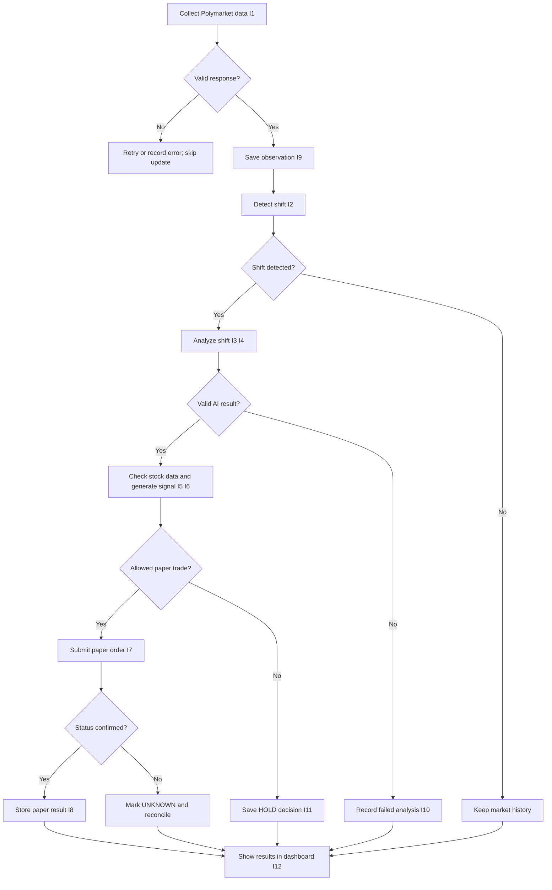
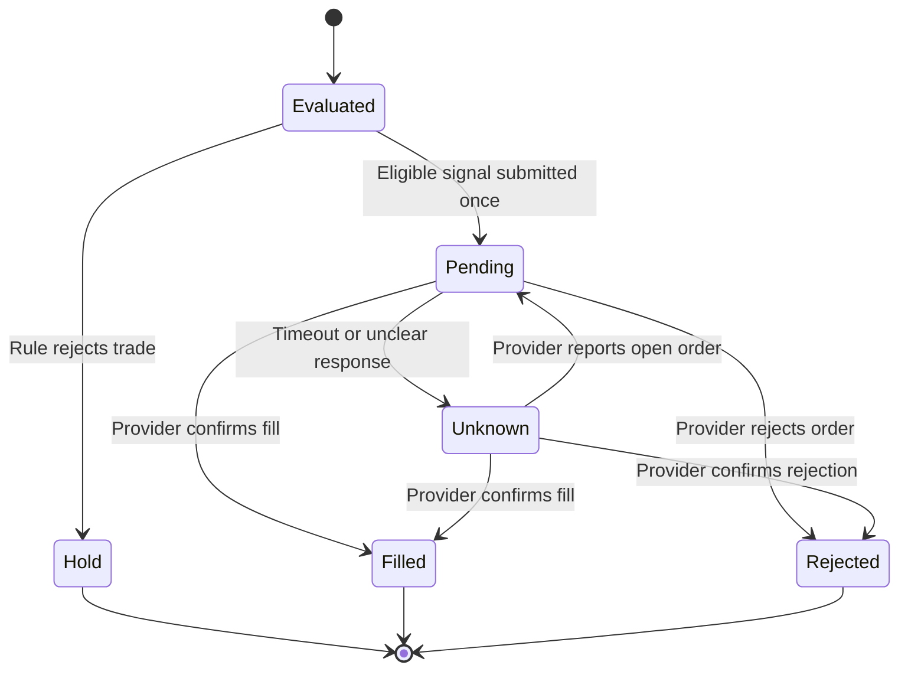

# D2_Detailed_Design

**Project:** Prediction Market Sentiment Trading System  
**Team members:** Vinesh and Charlie  
**Goal:** Use changes in Polymarket sentiment, relevant news, and stock market data to identify potentially affected companies, generate explainable signals, and evaluate them through paper trading. The system does not place real-money trades.

## 1. Header, conventions, and D2 overview

Our system collects Polymarket observations and compares current probabilities and trading volume with earlier data. When a significant shift occurs, a local Qwen3.5 9B model analyzes its possible effect on companies or industries. The Trading Signal Generator checks stock data and decides whether a simulated trade is appropriate. The dashboard displays results and lets researchers trace each signal back to its source information.

D0 defines six components and interfaces I1–I12. D1 covers **Data Storage**, **Sentiment Shift Detector**, and **AI Analysis Engine**, including the SQLite relationships, detection rules, analysis method, and component contracts. D2 completes the **Prediction Market Data Collector**, **Trading Signal Generator**, and **User Dashboard**, along with the supporting services needed to run them.

**Conventions:** Both D2 diagrams are written in Mermaid. Each diagram states its goal and explains its shapes and arrows. D0 interface numbers are unchanged. Field names in `monospace` are data or API fields; `PK` and `FK` retain their D1 meanings. All timestamps are UTC; probabilities and confidence values range from 0 to 1. Money uses decimal strings in APIs and integer cents in SQLite.

**Open questions:** The chosen stock-data and paper-trading providers, including their exact response formats and rate limits. We also need to benchmark the local AI model (Vinesh) and decide how to implement the historical backtesting step in UC-01, which is different from D0's paper trading workflow (Charlie). The original User Stories do not specify separate non-functional targets, so the performance goals in Section 6 are proposed rather than tested results.

## 2. Finished components, the D2 diagrams

### Prediction Market Data Collector — Vinesh

**Data model:** No new persistent data. It uses D1 `MARKET` and `MARKET_OBSERVATION`. A temporary market update contains `market_id`, `outcome`, `probability`, `volume_usd`, `observed_at`, and `source_record_id`.

**Behavior (DC-1):** (1) Request the latest update for each tracked market from Polymarket (I1). (2) Validate the market/outcome, probability `[0,1]`, nonnegative cumulative volume, and timestamp. (3) Normalize fields to the D1 observation format. (4) Save through `save_observation` (I9); ignore identical updates. (5) Trigger `detect_shift` (I2) only for a newly stored latest observation. (6) Record collection failures without inserting made-up data.

**Interface:**

```text
collect_market(market_id: string) -> CollectResult
CollectResult = {
  market_id: string,
  status: "stored" | "duplicate" | "skipped_stale" | "source_unavailable",
  observation_id: int | null,
  observed_at: UtcTime | null
}
```

**Errors:** `VALIDATION_ERROR` and `PROVIDER_SCHEMA_CHANGED` reject the update; `PROVIDER_TIMEOUT` and `PROVIDER_RATE_LIMIT` trigger at most three attempts with short backoff, then the next scheduled poll; `STORAGE_UNAVAILABLE` stops processing. The proposed polling interval is 60 seconds.

### Trading Signal Generator — Charlie

**Data model:** No new persistent table. It uses D1 `AI_ANALYSIS`, `COMPANY_IMPACT`, `TRADING_SIGNAL`, and `PAPER_TRADE`. The saved signal includes the stock price, timestamp, source, rule version, decision, and reason. The trade contains simulated order status, fill details, and nullable profit/loss. A stable client order identifier must be stored or associated with the trade; its exact D1 storage location needs confirmation.

**Behavior (SG-1):** (1) Read a completed AI analysis (I5). (2) Skip impacts without a verified ticker or clear positive/negative direction. (3) Check price, volatility, timestamp, and market status (I6). (4) Apply the proposed confidence minimum of 0.70 and reject stale prices (older than 120 seconds). (5) Produce `BUY`, `SELL`, or `HOLD` with a reason; `SELL` requires an existing paper position and no short selling is allowed. (6) Save the signal (I11). (7) For an allowed trade, submit one sandbox order (I7), then save/reconcile its result (I8). The proposed order size is $100, subject to simulated buying power.

**Interfaces:**

```text
StockSnapshot = {
  ticker: string, price_usd: USD, volatility: float,
  as_of: UtcTime, source: string, market_open: bool
}

generate_signals(analysis_id: int,
                 stock_snapshots: list<StockSnapshot>) -> list<SignalDecision>
SignalDecision = {
  signal_id: int, analysis_id: int, ticker: string,
  action: "BUY" | "SELL" | "HOLD", reason: string,
  confidence: float, status: "ready" | "hold" | "rejected"
}

submit_paper_order(signal_id: int) -> PaperOrderResult
PaperOrderResult = {
  signal_id: int, trade_id: int | null, client_order_id: string,
  status: "PENDING" | "FILLED" | "REJECTED" | "UNKNOWN",
  filled_price_usd: USD | null, executed_at: UtcTime | null
}
```

**Errors:** `ANALYSIS_NOT_FOUND` and `INVALID_ANALYSIS` prevent signal creation. `STALE_PRICE`, `PRICE_UNAVAILABLE`, `MARKET_CLOSED`, or `RISK_LIMIT` result in `HOLD`. `PAPER_API_UNAVAILABLE` leads to an `UNKNOWN` order status and provider reconciliation, not an automatic second order.

### User Dashboard — Charlie

**Data model:** **No persistent data.** React holds temporary filters and display state. The backend reads D1 market, shift, analysis, signal, and trade records without giving the browser direct SQLite access.

**Behavior (UI-1):** (1) Request a page of saved results through the backend. (2) Filter by market, ticker, date, or status. (3) Show the latest observations, detected shifts, AI explanations, signal reasons, simulated results, and source trace. (4) Refresh periodically (proposed: every 30 seconds). (5) Mark older cached results as stale if the backend becomes unavailable; never display an unconfirmed order as a completed trade.

**Interfaces:**

```text
GET /api/v1/dashboard?market_id?&ticker?&status?&limit?&offset?
  -> { items: list<DashboardRow>, total: int,
       last_updated: UtcTime | null, stale: bool }
GET /api/v1/signals/{signal_id}/trace -> SignalTrace
GET /api/v1/health -> { status: "ok" | "degraded", checked_at: UtcTime }

DashboardRow = {
  market_id: string, observed_at: UtcTime,
  probability: float, shift_id: int | null,
  analysis_id: int | null, ticker: string | null,
  action: "BUY" | "SELL" | "HOLD" | null,
  trade_status: string | null, pnl_usd: USD | null
}
SignalTrace = {
  signal_id: int, observation_ids: list<int>,
  shift_id: int, analysis_id: int,
  evidence_ids: list<string>, trade_id: int | null
}
ErrorResponse = { code: string, message: string, request_id: string }
```

The backend limits each page to 100 results. Invalid filters return HTTP 422, missing IDs return 404, and an unavailable database returns 503. The UI shows a clear error or stale-data message.

### Components already detailed in D1

| Component | Existing data model | Behavior and interface | D2 relationship |
|---|---|---|---|
| Data Storage — Charlie | `MARKET`, `MARKET_OBSERVATION`, `SENTIMENT_SHIFT`, `AI_ANALYSIS`, `COMPANY_IMPACT`, `TRADING_SIGNAL`, `PAPER_TRADE` | D1 `save_observation`; validates IDs, source data, and foreign keys | I8–I12; stores observations, analyses, signals, and trade outcomes |
| Sentiment Shift Detector — Vinesh | D1 `SENTIMENT_SHIFT`, linked to two observations | D1 `detect_shift`; default 15-minute window, 0.05 probability change, $1,000 volume increase | I2–I3; returns detected/no shift or insufficient data |
| AI Analysis Engine — Vinesh | D1 `AI_ANALYSIS` and `COMPANY_IMPACT` | D1 `analyze_shift`; verifies model JSON and evidence IDs | I3–I5, I10; records failed analyses, does not send invalid results |

### Supporting functions

These are small helpers for the existing six components, not new pipeline stages.

| Function | Data model | Behavior | Interface and failure response |
|---|---|---|---|
| Configuration — Vinesh | No persistent data; local settings file | Load and validate poll intervals, thresholds, model path, and sandbox settings at startup | `load_config() -> AppConfig`; `CONFIG_INVALID` prevents affected service from starting |
| Logging — Vinesh | Local rotating log file | Record component, time, request ID, and error code without exposing API keys | `log_event(event: AuditEvent) -> bool`; failed file write falls back to stderr |
| Local access control — Charlie | No persistent data | Bind the development API to localhost; remote use is out of scope without authentication | `authorize_request(client_ip: string) -> bool`; reject remote requests with 403 |
| Dashboard notices — Charlie | No persistent data; temporary UI state | Show failed-analysis, stale-data, and unknown-order messages | `show_notice(code: string, message: string)`; fall back to basic text if display fails |
| Paper API adapter — Charlie | Uses D1 `PAPER_TRADE` | Convert signals to sandbox requests, keep a stable order ID, and check uncertain order status | `submit_once(signal_id: int) -> PaperOrderResult`; timeout becomes `UNKNOWN` for reconciliation |

**D0 interface check:** I1–I4 cover collection, detection, and AI context; I5–I8 cover analysis-to-signal, stock data, paper requests, and paper results; I9–I12 cover data storage and dashboard reads. These links keep the meanings defined in D0. Each component passes saved IDs or typed records rather than the full internal database structure. Detailed provider field mappings will be finished after the external services are selected.

### Figure D2-1 — Main processing flow with errors

**Project goal:** Identify market sentiment changes, produce explainable signals, and evaluate them through paper trades. **Conventions:** Rectangles are actions, diamonds are decisions, and arrows show control flow. Labeled branches show failure or rejection paths.



### Figure D2-2 — Paper order lifecycle

**Project goal:** Record simulated orders without duplicating them after uncertain provider responses. **Conventions:** Nodes are order states. Labeled arrows are allowed transitions. `UNKNOWN` requires checking the provider before a final status can be recorded.



## 3. Edge cases and error handling

The following table focuses on **six high-risk cases**, one for each D0 component. Together, the cases cover boundary values, timing/concurrency, bad input, and external dependencies. Other expected errors are addressed in the interface descriptions above. **Note:** The assignment rubric asks for all four categories *for each component*; limiting this table to six cases does not provide that full coverage.

| ID | Component | Category | Edge case | Design decision (handler, response, recoverable?) |
|---|---|---|---|---|
| EC-01 | Data Collector | External dependency | Polymarket times out or rate-limits requests. | `Collector.fetch_update`: retry at most three times with backoff; then log failure and skip the poll. **Recoverable:** yes, next poll. |
| EC-02 | Sentiment Shift Detector | Boundary values | Probability/volume difference falls exactly on the configured threshold. | `ShiftDetector.detect_shift`: use `>=`; a matching threshold qualifies, with one stored shift per observation/configuration. **Recoverable:** yes; normal result. |
| EC-03 | AI Analysis Engine | Bad or missing input | Model returns malformed JSON or references evidence not supplied to it. | `AIAdapter.validate_output`: store failed analysis, do not pass it to signal generation; allow later reanalysis. **Recoverable:** yes, on a valid later attempt. |
| EC-04 | Trading Signal Generator | Timing/concurrency | Paper API times out after a request may have been accepted. | `PaperAdapter.reconcile`: save `UNKNOWN`, look up client order ID, never blindly resubmit. **Recoverable:** yes, after provider confirmation. |
| EC-05 | Data Storage | External dependency | SQLite is unavailable or the disk is full. | `StorageRepository.health_check`: stop new trades and writes; return `STORAGE_UNAVAILABLE` and surface degraded status. **Recoverable:** manual storage repair. |
| EC-06 | User Dashboard | Bad or missing input | Invalid filters or missing signal ID. | `DashboardAPI.validate_request`: return 422 or 404 with a clear message; do not show misleading data. **Recoverable:** yes, after correcting the request. |

## 4. Requirements traceability table

US-01 through US-03 and AC-01.1/AC-01.2 come from our original User Stories. The other requirements are derived from D0/D1 and marked as proposed; priorities are also proposed because the stories do not assign them.

| Requirement | Priority | Specific design element(s) and edge-case/figure references | How it is met / gap |
|---|---|---|---|
| US-01 — Detect significant sentiment shifts | Must | D1 `detect_shift`, `SENTIMENT_SHIFT`, Figure D2-1, EC-02 | Compares observations using probability and volume thresholds. |
| US-02 — Save timestamped market and stock data with sources | Must | D1 `MARKET_OBSERVATION`, `TRADING_SIGNAL.stock_snapshot_json`, `save_observation`, EC-01, EC-05 | Saves market records and stock inputs used by signals. |
| US-03 — Trace signals to original evidence | Must | D1 foreign keys linking observations, shifts, AI analyses, signals; `GET /api/v1/signals/{signal_id}/trace`, EC-05 | Retrieves the records and AI evidence behind a signal. |
| AC-01.1 — Identify at least one company/industry on success | Must | D1 `analyze_shift`, `COMPANY_IMPACT`, EC-03 | Analysis can return impacts. **Gap:** if no supported impact is found, the success criterion is not met; display that outcome clearly. |
| AC-01.2 — Record AI failure and retain data | Must | D1 `AI_ANALYSIS.status`, Figure D2-1, EC-03 | Saves a failure and prevents invalid AI results from creating signals, provided storage is available. |
| UC-01 — Analyze a shift and select historical backtesting | Must | D1 `analyze_shift`; proposed dashboard selection in UI-1 | **Gap:** backtesting algorithm and saved results are not yet specified; D0/D1 focus on paper trading. |
| DR-01 — Simulated trade and result | Must (proposed) | SG-1, `PAPER_TRADE`, Figure D2-2, EC-04 | Stores paper-only orders and confirmed outcomes. |
| DR-02 — Review data and simulated results | Must (proposed) | `GET /api/v1/dashboard`, `DashboardRow`, EC-06 | Displays history, signals, and outcomes with source references. |
| NFR-01 — Detect shifts reliably | Should (proposed) | D1 `detect_shift`, Figure D2-1, EC-02 | Test boundary and duplicate cases; success target in Section 6. |
| NFR-02 — Keep API responses responsive | Should (proposed) | Paginated `GET /api/v1/dashboard`, EC-05, EC-06 | Restrict pages to 100 items and benchmark response time. |
| NFR-03 — Avoid duplicate paper orders | Must (proposed) | `PaperAdapter.submit_once`, Figure D2-2, EC-04 | Reconcile uncertain submissions instead of repeating them. |
| NFR-04 — Use local AI and protect prototype access | Should (proposed) | D1 `llama.cpp`, `authorize_request`, EC-03 | Local AI and loopback-only API; not a production login system. |

**Reverse traceability:** Collector/DC-1 supports US-02; Detector/`detect_shift` supports US-01; AI/`analyze_shift` supports AC-01.1 and AC-01.2; Storage and signal-trace endpoint support US-02 and US-03; Signal Generator/SG-1 and Paper Adapter support DR-01 and NFR-03; Dashboard/UI-1 and notices support DR-02; configuration/logging support reliability and auditability under US-02/NFR-01; local access guard supports NFR-04. No separate login system, public hosting, real-money trading, or push notifications are planned. The two explicit gaps are historical backtesting and a successful AI analysis with no supported company impact.

## 5. Design rationale

These decisions build on the D0 decision log and D1's relational database, threshold detector, local AI model, and backend choices. The review asked for clearer error paths, metrics, and data contracts; the underlying D0/D1 architecture was not changed.

| ID | Decision and trade-off | Peer review |
|---|---|---|
| D2-01 | **We chose** validated observations over passing raw Polymarket responses **because** all later components need consistent fields. **We accepted the trade-off of** maintaining a provider adapter **because** it prevents bad data from reaching the detector. | Expanded validation details after review. |
| D2-02 | **We chose** scheduled polling over a continuous live stream **because** it is simpler for the first prototype. **We accepted the trade-off of** some delay between changes and collection **because** the system does not require instant execution. | No change. |
| D2-03 | **We chose** strict stock-data and confidence checks over turning every AI impact into a trade **because** AI output alone cannot justify a simulated order. **We accepted the trade-off of** fewer trades **because** recorded decisions are easier to explain and evaluate. | Clarified error outcomes after review. |
| D2-04 | **We chose** stable client order IDs and order reconciliation over automatic order resubmission **because** a timeout does not confirm failure. **We accepted the trade-off of** delayed results **because** duplicate simulated trades would make performance records unreliable. | Added explicit timeout behavior after review. |
| D2-05 | **We chose** a backend read API over direct browser access to SQLite **because** it keeps database logic in one place. **We accepted the trade-off of** additional endpoints **because** they allow validation, pagination, and signal tracing. | Expanded response schemas after review. |
| D2-06 | **We chose** local hosting and simple supporting functions over a public multi-user service **because** the project is built by two team members using existing hardware. **We accepted the trade-off of** no remote user accounts **because** authentication and public hosting would add work beyond the current scope. | No change. |

**Change note:** We did not edit D0 or D1 following the review. D2 adds detailed failure handling, proposed performance tests, and endpoint schemas in response to EpistemicRAG. Any later database change needed to store a paper provider's client order ID will be documented as a D1 correction.

## 6. Peer design review notes

**Reviewing team:** EpistemicRAG. They liked the project's goals, overall architecture, workflows, and separation of components. They asked us to explain serious error cases, define measurable performance expectations, and make the API data formats more specific.

| ID | Criterion | Issue and reviewing team | Action | Owner | Priority | Due date |
|---|---|---|---|---|---|---|
| PR-01 | Risk | EpistemicRAG: limited explanation of timeouts and invalid data | Add named error handling and recovery behavior in component descriptions and EC-01–EC-06 | Vinesh and Charlie | High Priority | Before D2 submission |
| PR-02 | Feasibility | EpistemicRAG: no measurable evaluation targets | Define testable goals for ingestion, detection, API responsiveness, and duplicate orders | Vinesh and Charlie | High Priority | Before D2 submission |
| PR-03 | Clarity | EpistemicRAG: API fields and response formats need detail | Specify typed collector, signal, and dashboard contracts in Section 2 | Vinesh and Charlie | High Priority | Before D2 submission |

**Proposed performance checks (not measured results):**

| Metric | Proposed target | Test |
|---|---|---|
| Collector validation | All malformed test inputs are rejected without reaching detection | Replay 100 valid/invalid market updates |
| Shift detection correctness | All 100 expected shift/no-shift outcomes match | Unit tests including threshold boundaries and ordering |
| Dashboard responsiveness | p95 response time under 500 ms on local test data | Measure 1,000 paginated backend requests |
| Paper order duplication | Zero duplicate submissions for the same signal | Simulate provider timeout and repeated callbacks |

**Review summary:** EpistemicRAG raised one concern each about risk, feasibility, and clarity, so no single category received more comments. Their review did not require changes to the D0 or D1 architecture, but the D2 descriptions and evaluation plan were expanded.

**Our feedback to another team:** We suggested (1) explaining how the team will test accuracy and system performance, and (2) defining measurable criteria for deciding when its results are good enough. We also noted their focus on privacy, affordability, and reducing AI hallucinations. The full feedback is recorded in `Peer_Review_Notes.md`.
